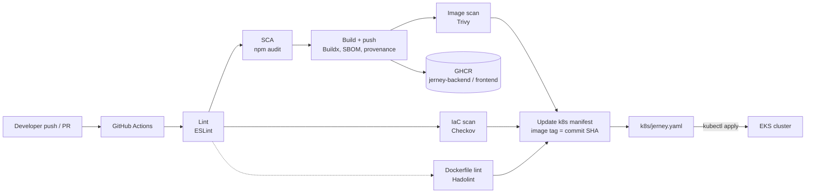
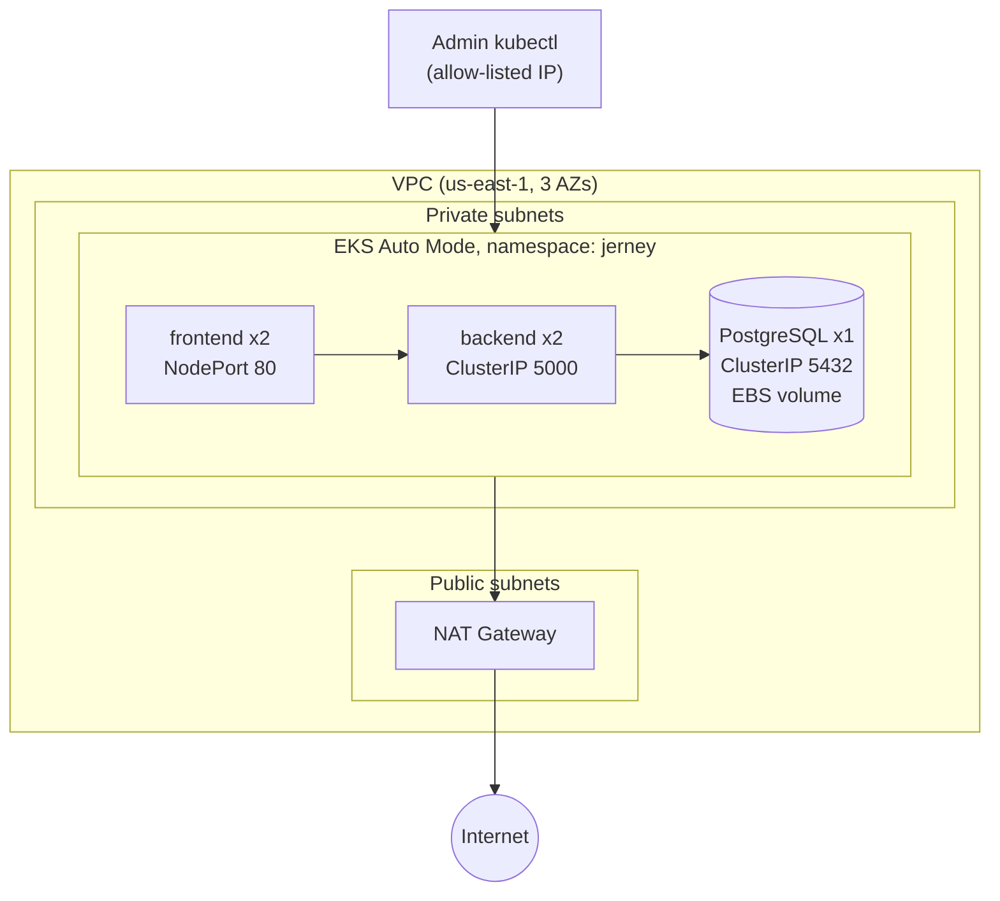

# Jerney DevSecOps: Secure CI/CD and EKS Infrastructure on AWS

[](https://github.com/Sanket4404/DevSecOps-Project/actions/workflows/ci-cd.yml)


A security-first delivery pipeline and AWS infrastructure for a 3-tier web app (React, Node.js, PostgreSQL).
Every push is linted, dependency-audited, built into a container image, and scanned for vulnerabilities and misconfigurations. Only after all gates pass does the pipeline update the Kubernetes manifest that runs on a Terraform-provisioned EKS cluster.

> **Scope:** the Jerney blog app is the workload. [CONFIRM: the application source was provided as a sample.] The work in this repo is the platform around it: the pipeline, container hardening, security scanning, Terraform infrastructure and Kubernetes deployment.

---

## What this project demonstrates

| Skill | Where to look |
|---|---|
| CI/CD with GitHub Actions | `.github/workflows/ci-cd.yml` (7 stages, matrix builds) |
| DevSecOps (shift-left security) | Trivy image scan, Checkov IaC scan, Hadolint, npm audit |
| Infrastructure as Code | `terraform/` (VPC + EKS Auto Mode using community modules) |
| Containers | Hardened Dockerfiles, images pushed to GHCR with SBOM and provenance |
| Kubernetes on AWS | `k8s/jerney.yaml` on EKS Auto Mode: Deployments, Services, Secret, EBS-backed PVC |
| Kubernetes network security | NetworkPolicies: database accepts backend only, backend accepts frontend only |
| AWS networking | 3-AZ VPC, public and private subnets, NAT gateway |
| Automated promotion | Bot commit updates image tags only after all gates pass |

---

## Architecture

### Delivery flow



The pipeline stops at the manifest update. Applying the manifest to the cluster is currently a manual `kubectl apply` (see the roadmap for GitOps with Argo CD).

### AWS infrastructure (Terraform) and workload



The application is intentionally **not exposed to the internet**: there is no load balancer or ingress. It is reached through `kubectl port-forward` (see below).

---

## CI/CD pipeline

Workflow: `.github/workflows/ci-cd.yml`. Runs on every push and pull request. Default token permissions are read-only; jobs request more only where needed (`packages: write` for the build, `contents: write` for the manifest update).

| # | Stage | Tool | What it does | Blocks the pipeline? |
|---|---|---|---|---|
| 1 | Lint | ESLint | Lints backend and frontend (matrix) | Yes |
| 2 | Dependency audit (SCA) | `npm audit` | Flags high-severity dependency issues | No (report-only) |
| 3 | Build and push | Docker Buildx | Builds images, pushes to GHCR with SBOM and provenance. Tags: commit SHA, branch, `latest` on main. No push on PRs | Yes |
| 4 | Image scan | Trivy | Scans for CRITICAL and HIGH vulnerabilities (OS and libraries, unfixed ignored) | Yes |
| 5 | IaC scan | Checkov | Scans `terraform/` (blocking) and `k8s/` (report-only) | Terraform: yes, k8s: no |
| 6 | Dockerfile lint | Hadolint | Checks Dockerfile best practices | Yes |
| 7 | Manifest update | Shell + git | On pushes to `main` only, after stages 3, 4, 5 and 6 pass: sets new image tags in `k8s/jerney.yaml` and commits as `github-actions[bot]` with `[skip ci]` | n/a |

Second workflow: `sim-security-scan.yml`. [CONFIRM: one line on what it does.]

### Suppressed Checkov checks

| Check | Reason it is skipped |
|---|---|
| `CKV_AWS_39` | [CONFIRM: reason] |
| `CKV_AWS_58` | [CONFIRM: reason] |
| `CKV_TF_1` | [CONFIRM: reason] |

### Security findings fixed

| Finding | Tool | Fix |
|---|---|---|
| [CONFIRM: e.g. vulnerable base image / OS package] | Trivy | [CONFIRM: e.g. moved to a slim, patched base image] |
| [CONFIRM: e.g. container running as root] | Checkov / Hadolint | [CONFIRM: e.g. added non-root USER] |
| [CONFIRM: Terraform finding] | Checkov | [CONFIRM: what changed in `terraform/`] |

Evidence that the gates work: see the failed run #3 in the [screenshots](#screenshots) below, where three scanners failed and the manifest update was skipped.

---

## Infrastructure (Terraform)

Files: `terraform/main.tf`, `variables.tf`, `outputs.tf`, `provider.tf`, `terraform.tfvars`.

- **VPC** (`terraform-aws-modules/vpc/aws`, `~> 5.0`): `10.0.0.0/16` across `us-east-1a`, `1b` and `1c`. Three private `/20` subnets (`10.0.0.0/20`, `10.0.16.0/20`, `10.0.32.0/20`) and three public `/24` subnets (`10.0.48.0/24`, `10.0.49.0/24`, `10.0.50.0/24`). Private subnets route to the internet through a **single NAT gateway** in `us-east-1a`; public subnets route through the internet gateway. Subnet tags let EKS place internal and public load balancers.
- **EKS** (`terraform-aws-modules/eks/aws`, `~> 20.31`): Kubernetes 1.36 in **Auto Mode** with `general-purpose` and `system` node pools, worker capacity in private subnets. No self-managed node groups, Fargate profiles or add-ons to maintain.
- **Security controls**
  - Kubernetes secrets encrypted at rest (envelope encryption)
  - Control plane logging enabled: api, audit, authenticator, controllerManager, scheduler
  - Public API endpoint restricted to an admin allow-list, private endpoint also enabled
  - API-based cluster authentication

## Kubernetes workload

Manifest: `k8s/jerney.yaml`, namespace `jerney`.

| Resource | Details |
|---|---|
| Namespace | `jerney` |
| Secret | `jerney-db-secret` (database credentials) |
| StorageClass + PVC | `jerney-ebs-sc`, `jerney-db-pvc`: EBS-backed volume so database data survives pod restarts |
| Deployments | `jerney-frontend` (2 replicas), `jerney-backend` (2 replicas), `jerney-db` (1 replica) |
| Services | frontend `NodePort` 80, backend `ClusterIP` 5000, database `ClusterIP` 5432 |
| NetworkPolicies | `jerney-db-allow-backend-only`: database accepts traffic from the backend only. `jerney-backend-allow-frontend-only`: backend accepts traffic from the frontend only |

### Design decisions

| Decision | Why |
|---|---|
| Single NAT gateway | Saves cost in a dev environment. Production should use one per AZ |
| EKS Auto Mode | AWS manages node groups and core add-ons, so less operational overhead |
| Image tag = commit SHA | Every deployment is traceable to an exact commit and easy to roll back |
| Scan gate before manifest update | A vulnerable image can reach the registry but can never be promoted to the cluster manifest |
| No public load balancer | Smaller attack surface for a demo. Access is through an authenticated `kubectl port-forward` |
| NetworkPolicies per tier | Limits lateral movement: a compromised frontend pod cannot reach the database |

---

## Screenshots

### CI/CD pipeline

**Successful run** (commit `10181b4`, 2m 24s): lint, dependency audit, build, image scan, IaC scan and Dockerfile lint all pass, then the Kubernetes manifest is updated.


### AWS EKS

**Cluster overview:** Active, Kubernetes 1.36, 1 node, 5 pods, 0 managed node groups (EKS Auto Mode manages compute). Account identifiers are redacted.


**Workloads running** (5 pods: 2 backend, 2 frontend, 1 database):


**Workload status:** 5 of 5 pods, 3 of 3 deployments and 3 of 3 ReplicaSets running (100%).


### VPC

**Resource map:** 3 public and 3 private subnets across 3 availability zones, separate public and private route tables, and a single NAT gateway.


---

## Run it yourself

**Prerequisites:** AWS account and CLI configured, Terraform, kubectl, Docker.

```bash
# 1. Provision the VPC and EKS cluster
cd terraform
terraform init
terraform plan
terraform apply

# 2. Connect kubectl
aws eks update-kubeconfig --region us-east-1 --name jerney-eks

# 3. Deploy the application
kubectl apply -f ../k8s/jerney.yaml
kubectl get pods,svc -n jerney -o wide

# 4. Open the app (no public load balancer, so use port-forward)
kubectl port-forward -n jerney svc/jerney-frontend 8080:80
# then browse to http://localhost:8080

# 5. Tear everything down (EKS and the NAT gateway are billed hourly)
kubectl delete -f ../k8s/jerney.yaml
terraform destroy
```

Before applying, put your own IP in the admin allow-list variable (`admin_cidrs`).
Never commit credentials. Pass the database password through a Kubernetes Secret created at deploy time or an external secrets manager, not a plaintext file in the repo.

Run the app locally without Kubernetes:

```bash
docker compose up --build
```

---

## Troubleshooting

**`kubectl` times out (`dial tcp [64:ff9b::…]:443: i/o timeout`)**

- **Cause 1: allow-list drift.** The cluster API endpoint only accepts the CIDR in `admin_cidrs`. Home ISPs rotate public IPs, so the stored address stops matching. Check with `aws eks describe-cluster --name jerney-eks --query cluster.resourcesVpcConfig.publicAccessCidrs` and compare with `curl -4 ifconfig.me`.
- **Cause 2: IPv6 / NAT64 route.** The `64:ff9b::` addresses mean the network was sending kubectl traffic through an IPv6-to-IPv4 translator, so AWS saw a different source IP than the allowed one. Fix: force IPv4 for the session (`sudo sysctl -w net.ipv6.conf.all.disable_ipv6=1`), then re-enable it afterwards.
- **Diagnostic:** `curl -4 -k -m 10 https://<endpoint>/version`. An HTTP 401 means the network path works (only credentials are missing). A timeout means the request is being dropped.

**Pods show `ImagePullBackOff`:** images in GHCR are private by default. Make the packages public or create an image pull secret.

---

## Repository structure

```
.
├── .github/workflows/
│   ├── ci-cd.yml               # 7-stage DevSecOps pipeline
│   └── sim-security-scan.yml   # [CONFIRM: purpose]
├── backend/                    # Node.js / Express API + Dockerfile
├── frontend/                   # React (Vite) + Nginx + Dockerfile
├── k8s/                        # Kubernetes manifest
├── terraform/                  # VPC + EKS Auto Mode
├── deploy/                     # Earlier EC2 bare-metal deployment (setup.sh, nginx conf)
├── docker-compose.yml          # Local run
└── .checkov.yml                # Checkov configuration
```

The original application README (features, API endpoints, EC2 deployment) is in [`docs/APP-README.md`](docs/APP-README.md).

---

## Roadmap

- [ ] Pin tool versions (`trivy-action`, Checkov image) instead of `master` and `latest`
- [ ] Make `npm audit` and Kubernetes Checkov blocking once existing findings are fixed
- [ ] Add GitOps with Argo CD so the cluster syncs automatically from the manifest the pipeline updates (removes the manual `kubectl apply`)
- [ ] Move the database credentials out of the manifest (External Secrets or Sealed Secrets)
- [ ] Expose the app through an AWS Load Balancer Controller ingress with TLS
- [ ] Add Prometheus and Grafana for cluster and application monitoring
- [ ] Remote Terraform state (S3 backend with locking)
- [ ] One NAT gateway per AZ for production-grade availability

---

## Author

**Sanket Shinde**: Junior DevOps & Cloud Engineer
[LinkedIn](https://www.linkedin.com/in/sanketshinde-dev) · [GitHub](https://github.com/Sanket4404) · sanketshinde4404@gmail.com
